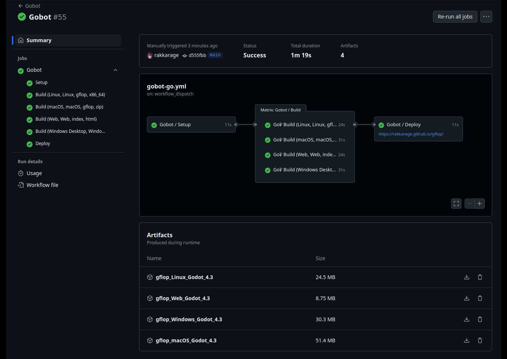
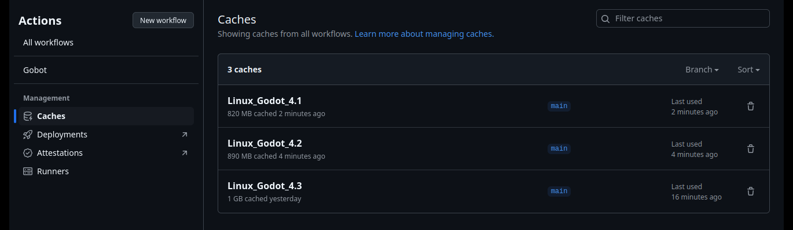

# Gobot

This workflow is designed to automate the process of building and deploying Godot projects.

## Features

- Caches Godot and templates, so only downloads once.
- Parses build settings from `export_presets.cfg` to generates a custom strategy matrix to run all builds concurrently.
  - Do not need to set file names or paths just have the platform present in the file.
  - Will use your file and extension names if set. Except web which will use `index.html` to deploy correctly.
  - If have wrong `Linux`/`Linux/X11` platform name for supplied version in `export_presets.cfg`, will rewrite it.
- Deploys web artifact to the repository GitHub Pages environment.
  - Optionally deletes old repository GitHub Pages deployments.
  - This only really works with Godot >= 4.3 (and some 3.x versions for a while)

> [!WARNING]
> Old repository GitHub Pages deployments can be deleted.

## Workflow Overview

## Inputs

- `godot-version`: Godot version to build with (default: `4.7`).
- `imply-platform`: Platform to imply if `export_presets.cfg` is missing or empty (default: `Web`).
- `environment`: GitHub Pages environment for the web deploy.
- `delete-old-pages`: Delete previous Pages deployments before deploying.

## Jobs

- **Setup**
  - Analyze input to generate a dynamic build matrix, and Cache Godot and Export Templates.
- **Build**
  - Export the project for each target platform concurrently.
- **Deploy**
  - Deploy web build to Pages after optionally deleting old Pages deployments.

## Usage

Ensure build platforms are defined in `export_presets.cfg`. If it's missing or empty, a minimal `Web` preset is implied by default (set `imply-platform` to change the platform, or empty to fail).

If you have a web build, enable `Build and Deployment from GitHub Actions` in repo/settings/pages.

To use the workflow, call it from another workflow using (for example) the `workflow_dispatch` event and provide the inputs:

Files:

- `gobot.yml`: This is the **reusable** or **called** workflow. You can leave this file here or copy it anywhere.
- `gobot-go.yml`: This is the **calling** or **caller** workflow. This is the file you would use in your project's `.github/workflows` directory to call the reusable `gobot.yml` workflow.

```yaml
name: Gobot
on:
  workflow_dispatch:
    inputs:
      godot-version:
        description: Godot Version
        default: '4.7'
        type: string
      imply-platform:
        description: Imply Platform
        default: 'Web'
        type: string
      environment:
        description: Pages Environment
        default: github-pages
        type: environment
      delete-old-pages:
        description: Delete Old Pages
        default: false
        type: boolean
permissions:
  pages: write
  id-token: write
  deployments: write
jobs:
  Gobot:
    uses: rakkarage/auto/.github/workflows/gobot.yml@main
    with:
      godot-version: ${{ inputs.godot-version }}
      imply-platform: ${{ inputs.imply-platform }}
      environment: ${{ inputs.environment }}
      delete-old-pages: ${{ inputs.delete-old-pages }}
```

## Screenshots




## Todo

- gen win icon with `rcedit`?
- cache project import files in .godot folder?
